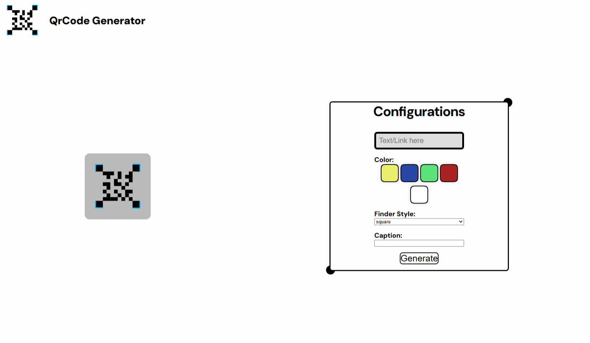
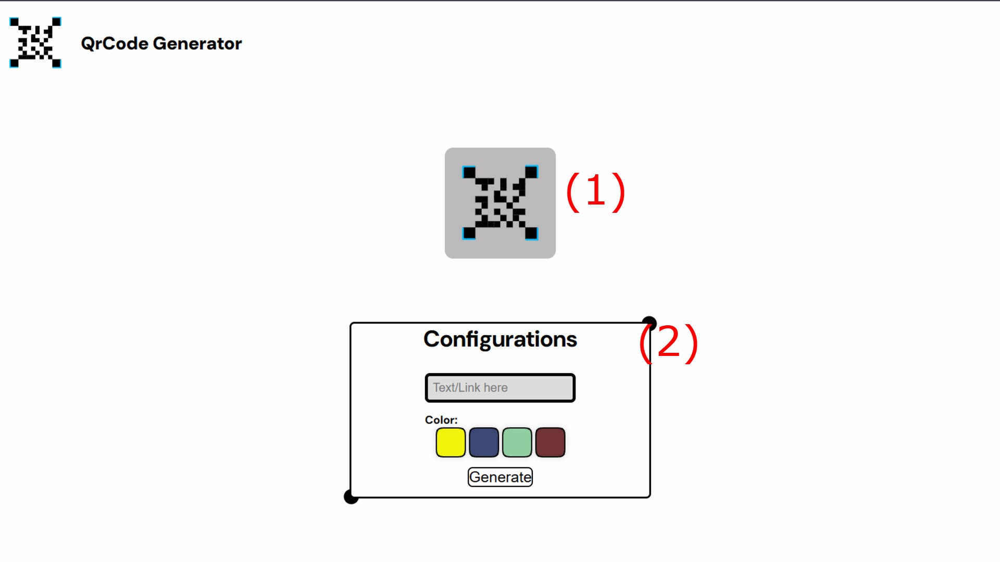

# QrCode Generator

QrCode generator is a website where you put text / a url and it creates a Qr Code almost instantly!

You can use it [here](https://brundevcoder.github.io/QrCodeGenerator/)

## How to use:

When you open the website, you'll see a display (1), and a configuration panel (2)

In the settings panel, you must enter the text or url you want and choose a color from the avaiable options and press the generator Button!
Also, you can now choose the Finder Style and insert an caption to the QrCode!

## How to run it locally?
You can clone this repo by this command: `git clone https://github.com/BrundevCoder/QrCodeGenerator` and then open the index.html file, or you can use the Live Server extension to open it!